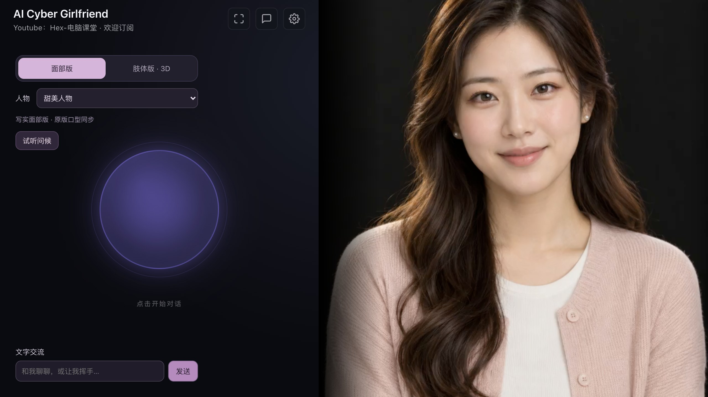
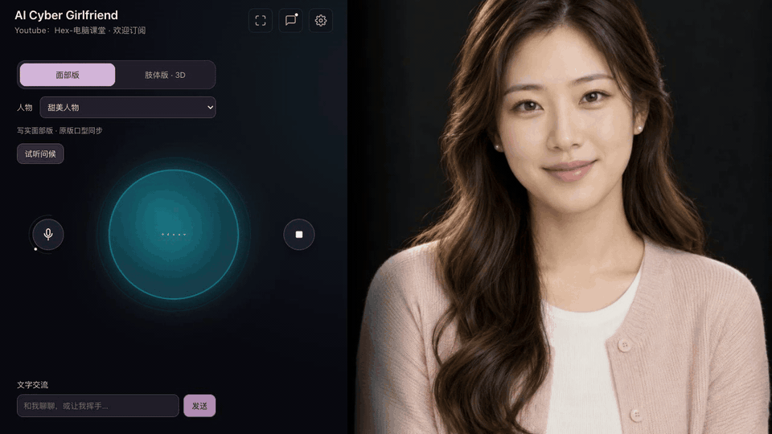
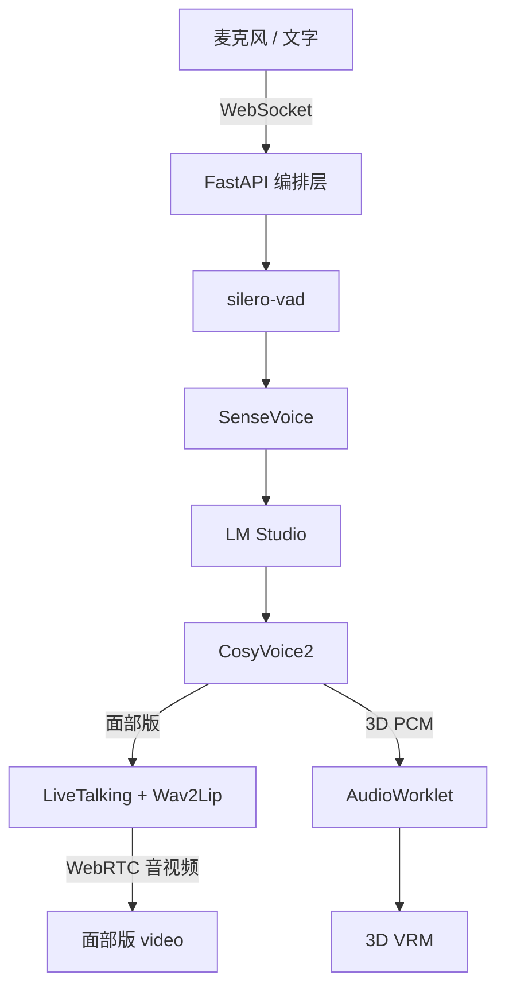

<!--
  Hex AI Girlfriend — 本地实时数字人语音对话
  Copyright (C) 2026 Hex-电脑课堂
  YouTube: https://www.youtube.com/channel/UC2s3nBn_v4So9-8GQORMDhA
  SPDX-License-Identifier: GPL-3.0-or-later
-->
# Mac AI Girlfriend · Apple Silicon 本地数字人

在 Mac 上本地运行的实时语音数字人：SenseVoice 识别中文，LM Studio 生成回复，CosyVoice2 用参考音色说话。同一网页可切换照片面部版与可做全身动作的 3D 肢体版，支持语音对话、文字交流、动作预览和插话打断。

**运行时全部在本机完成，不需要云端 API Key。** 首次安装、下载模型与素材需要联网。

本 README 以原生 Mac 部署为主；Windows / WSL2 / Ubuntu 的原版步骤见 [README_ORIGINAL.md](README_ORIGINAL.md)。

**文档入口**：[Mac 实现细节](README_MAC.md) · [3D 制作记录](scripts/README-character3d.md) · [原版 README 归档](README_ORIGINAL.md) · [历史英文说明](README_EN.md)

**v2 独立目录**：[v2/](v2/README.md)（DeepSeek Harness 版，网页端口 `7861`）。

## 目录

- [界面与演示](#界面与演示)
- [项目特点](#项目特点)
- [技术栈](#技术栈)
- [系统要求](#系统要求)
- [快速开始](#快速开始)
- [使用指南](#使用指南)
- [架构与数据流](#架构与数据流)
- [配置](#配置)
- [性能与延迟](#性能与延迟)
- [验证与测试](#验证与测试)
- [已知限制](#已知限制)
- [常见问题](#常见问题)
- [项目结构](#项目结构)
- [相关文档](#相关文档)
- [素材来源与许可](#素材来源与许可)

## 界面与演示

以下截图和动图来自本机实际运行的 Mac 版，使用甜美人物素材，不是渲染稿。





文字交流与语音共用同一套本地模型和克隆声音；动图为提问“给我讲个笑话”后的实际回复。完整对话可在右上角“对话记录”中查看。

## 项目特点

- **全本地推理**：语音识别、对话、克隆语音、面部口型和 3D 口型都在本机完成；运行时不需要云端 API。
- **两种人物形态**：照片面部版保留原人物与甜美人物两套素材；3D 版是自定义 VRM，52 根标准骨骼，可挥手、点头、思考、讲述、鞠躬、走动和跳舞。
- **自然语音链路**：支持麦克风对话、文字交流、试听问候和插话打断；面部版的声音与视频走同一条 WebRTC 连接。
- **短回复与预缓冲**：默认先说一小段，需要时用“继续”展开；整段语音预先生成再播放，优先保证连续性和口型稳定。
- **Apple Silicon 加速**：MLX / Metal、Core ML、MPS 和 VideoToolbox 分别承担语音解码、声学估计、口型与视频编码。
- **一键安装与启动**：`./install.sh` 安装项目依赖与素材，`./scripts/start-mac.sh` 启动数字人与网页。

## 技术栈

| 层 | 技术 | 在本项目中的用途 |
|---|---|---|
| 前端交互 | 原生 HTML / CSS / JavaScript、WebSocket、WebRTC、Web Audio / AudioWorklet | 无前端框架；麦克风采集、PCM 播放、状态与字幕 |
| 3D 渲染 | Three.js、three-vrm、自定义 VRM | 浏览器内全身骨骼、动作、表情与音频驱动口型 |
| 服务层 | Python 3.11、FastAPI、Uvicorn、asyncio | 静态页面、Realtime 风格 WebSocket、LiveTalking 反向代理 |
| 对话模型 | LM Studio / llama.cpp / Metal、`dolphin3.0-llama3.1-8b` | 本地 LLM，提供 OpenAI 兼容 API |
| 语音识别 | SenseVoiceSmall / FunASR、silero-vad | 中文语音识别与端点检测 |
| 语音合成 | CosyVoice2-0.5B、MLX FP16、Core ML | 参考音色克隆、声学估计、HiFT 声码器 |
| 面部口型 | Wav2Lip256 / Core ML、LiveTalking | 实时嘴型与 WebRTC 音视频回传 |
| 离线素材 | LivePortrait（固定提交） | 生成两套面部素材的眨眼帧，仅在安装阶段运行 |
| 媒体传输 | WebRTC、VideoToolbox H.264 | 面部版同轨音视频与 25fps 视频编码 |

### Apple Silicon 加速

| 环节 | 执行方式 |
|---|---|
| 对话 LLM | LM Studio / Metal |
| 中文语音识别 | SenseVoiceSmall / CPU，量化并预热 |
| 克隆语音 token | 原 CosyVoice2 权重，MLX / Metal FP16 |
| 声学估计 | Core ML GPU；不适用的输入保留 PyTorch 回退 |
| 声码器 | HiFT / CPU |
| 面部口型 | Wav2Lip256 / Core ML，由系统调度 CPU、GPU 或 Neural Engine |
| 面部视频编码 | VideoToolbox H.264，目标 25fps |
| 3D 渲染 | 浏览器 WebGL / Three.js，52 根骨骼 |
| 3D 音频 | 本地 PCM → AudioWorklet → 同一输出 Analyser 驱动嘴部 |

## 系统要求

| 项目 | 要求 |
|---|---|
| 芯片 | Apple Silicon（`arm64`）；安装脚本会检查架构 |
| 已验证机器 | Apple M4、24GB 统一内存、macOS 26.6.2；这是实测配置，不是最低配置保证 |
| Python | 3.11，由 `uv` 创建项目内的 `.venv` |
| 本地工具 | `git`、`uv`、`ffmpeg`；[LM Studio](https://lmstudio.ai/) 及其 `lms` 命令 |
| 浏览器 | 支持 WebRTC、AudioWorklet 和 WebGL；使用 `localhost` 访问麦克风 |
| 模型 | SenseVoiceSmall、CosyVoice2、Wav2Lip、silero-vad，以及 LM Studio 中的对话模型 |
| 端口 | `7860` 网页、`8010` 数字人、`8200` LM Studio |
| 磁盘与网络 | 首次安装需要联网和额外磁盘空间；模型与预处理缓存不全部随 Git 分发 |

使用包含当前 `scripts/`、`web/assets/` 和 `data/avatars/` 的完整项目目录。3D 成品模型缺失时，需要按 [3D 制作记录](scripts/README-character3d.md) 单独重建；普通安装脚本不会重新执行图像生成和完整 3D 建模。

## 快速开始

### 安装与启动一览

| 步骤 | 命令或操作 | 执行频率 |
|---|---|---|
| 1. 准备工具 | `brew install git uv ffmpeg` | 一次 |
| 2. 一键安装 | `./install.sh` | 一次；更新依赖时可再执行 |
| 3. 准备模型 | 在 LM Studio 中下载对话模型 | 一次 |
| 4. 启动模型服务 | `lms server start` + `lms load` | 每次 |
| 5. 一键启动 | `./scripts/start-mac.sh` | 每次 |
| 6. 打开网页 | <http://localhost:7860> | 每次 |

### 1. 准备工具

如果已经使用 Homebrew：

```bash
brew install git uv ffmpeg
```

确认 `uv`、`ffmpeg` 和 `lms` 可执行：

```bash
uv --version
ffmpeg -version
lms --help
```

若提示找不到 `lms`，先完成 LM Studio 的 CLI 安装或路径配置。

### 2. 一键安装

```bash
git clone https://github.com/fendouai/mac-ai-girlfriend.git
cd mac-ai-girlfriend
./install.sh
```

在 macOS 上，`./install.sh` 会进入 `scripts/install-mac.sh`，主要完成：

- 创建 Python 3.11 的 `.venv`，安装 [锁定依赖](requirements-mac.lock.txt)；
- 下载并校验声音模型、Wav2Lip 与 S3FD 权重；
- 转换 Wav2Lip 与 CosyVoice2 Flow 的 Core ML 模型；
- 使用 LivePortrait 固定提交准备两套面部眨眼素材；
- 复用已有模型与缓存，重复执行会跳过已完成部分。

首次安装需要联网，耗时取决于网络和机器。它**不会**安装 LM Studio、下载对话模型，也不会重建缺失的 3D 成品；这三项分别见下一节和 [3D 制作记录](scripts/README-character3d.md)。

若终端提示脚本不可执行：

```bash
chmod +x install.sh scripts/install-mac.sh scripts/start-mac.sh scripts/start-avatar-mac.sh
```

### 3. 准备本地对话模型

在 LM Studio 中下载模型，默认使用 `dolphin3.0-llama3.1-8b`。用下面的命令确认已经可用：

```bash
lms ls
```

如果换用其他模型，需要同步修改 [config.mac.yaml](config.mac.yaml) 中的 `llm.model`，使其与服务返回的模型 ID 一致。不要把尚未下载的模型名称直接当作已安装模型使用。

### 4. 一键启动

先启动 LM Studio 的本地 API 并加载模型，再启动数字人与网页：

```bash
# 每次启动：启动 LM Studio API，并加载默认模型
lms server start --port 8200 --bind 127.0.0.1
lms load dolphin3.0-llama3.1-8b --gpu max --context-length 4096 \
  --identifier dolphin3.0-llama3.1-8b --yes

# 一条命令启动数字人（8010）与网页（7860）
./scripts/start-mac.sh
```

模型已加载且 `8200` 服务已在运行时，可以跳过前两条命令。

浏览器打开：

- 面部版：<http://localhost:7860/?avatar=face>
- 3D 肢体版：<http://localhost:7860/?avatar=body>

首次启动会预热语音模型；`engines_ready` 为 `false` 时仍在预热，变为 `true` 后即可对话：

```bash
curl -fsS http://127.0.0.1:7860/api/health
```

正常就绪结果：

```json
{"ok":true,"engines_ready":true,"startup_error":null}
```

`engines_ready: false` 表示仍在预热；若 `startup_error` 非空，先处理该错误。网页能打开不代表模型已经加载完成。

### 5. 停止、重启与日志

在运行 `start-mac.sh` 的终端按 **Ctrl+C**，脚本会停止它创建的网页和数字人进程。LM Studio 独立运行，需要时单独停止：

```bash
lms server stop
```

再次启动时重复上面的“一键启动”命令。数字人日志：

```bash
tail -f logs/avatar-mac.log
```

需要把网页、识别与语音生成日志保存到文件时：

```bash
./scripts/start-mac.sh > logs/mac.log 2>&1
```

再在另一个终端执行 `tail -f logs/mac.log`。改动后端配置后重启服务；改动前端代码后刷新页面。

## 使用指南

### 面部版与 3D 版

| 版本 | 人物与驱动 | 当前能力与限制 |
|---|---|---|
| 面部版 | 原人物、甜美人物两套干净照片；原版 Wav2Lip256 / Core ML 驱动嘴部 | 自然眨眼、说话口型；身体和背景保持静止。大幅口型、牙齿和表情联动仍受原模型限制 |
| 肢体版 · 3D | 根据 GPT 生成的虚构成年亚洲女性图片重建的甜美人物 VRM，52 根标准骨骼 | 挥手、点头、思考、讲述、鞠躬、原地走动和跳舞；有眼睑与嘴部形变。口型由实际播放音频驱动，尚非中文音素级精确对齐 |

### 语音对话

- **试听问候**：运行真实本地对话和克隆语音，不开启硬件麦克风。
- **点击开始对话**：授予麦克风权限后进行语音聊天；界面区分聆听、生成和播放状态。
- 默认请求回声消除、降噪和自动增益，但不能保证过滤所有环境声。
- 网页噪声门默认约 `-50 dBFS`；可在设置中按环境调整。

### 文字交流与动作

- **文字交流**：输入文字，也可以要求 3D 人物执行已支持的动作。
- **动作按钮**：直接预览挥手、点头、思考、讲述、鞠躬、走动和跳舞，不必等待模型理解指令。
- **继续展开**：默认先说一小段；需要更多内容时说或输入“继续”，再生成下一段，不自动连发整篇。

### 切换、打断与页面设置

- 切换版本或面部人物会结束当前语音会话；切换后重新点击开始对话。
- 连接会主动释放，避免快速切换耗尽 WebRTC 会话名额。
- 插话打断会取消旧的 token 生成、清理队列并停止旧口型。
- 版本也可通过 URL 指定：`/?avatar=face`、`/?avatar=body`；之后的切换会同步更新 URL。
- 设置中的麦克风、扬声器、人设、噪声门和字幕开关会保存在当前浏览器本地存储。
- 网页人设可以覆盖服务端人设；修改 `persona.md` 后若仍显示旧人设，检查网页设置。

## 架构与数据流



文字输入从编排层直接进入对话模型，不经过 VAD / 语音识别；上图省略了该分支。两条播放路径分别是：

- **面部版**：生成的声音送入 LiveTalking，Wav2Lip 生成嘴型，声音与人物视频通过同一条 WebRTC 连接回到浏览器。
- **3D 版**：PCM 通过 WebSocket 回到浏览器，AudioWorklet 播放并用同一播放时钟驱动嘴部；Three.js 在本地渲染人物。
- 两条路径共享同一套识别、对话和克隆语音模型；各 WebSocket 独立保存会话、VAD、历史和取消状态。

## 配置

Mac 默认读取 [config.mac.yaml](config.mac.yaml)，人设位于 [persona.md](persona.md)。

| 配置 | 用途 |
|---|---|
| `llm.base_url`、`llm.model` | 本地模型 API 地址和模型 ID |
| `llm.max_tokens` | 最大生成 token 数；不等同于汉字数或音频秒数 |
| `llm.max_reply_chars`、`llm.max_reply_sentences` | 语音回复上限，默认最多 40 字、两句；通常提示模型只说 10～24 字 |
| `tts.ref_wav`、`tts.ref_text` | 参考录音及其逐字文本；换音色时一起修改 |
| `tts.speech_backend` | 默认 `mlx`；改为 `torch` 可使用 PyTorch 路径 |
| `tts.speech_dtype` | MLX 默认 `float16`，也可使用 `float32` 对照 |
| `tts.chunk_ms` | 默认 `0`：整段合成后播放，以保证连续性 |
| `avatar.id` | 默认面部人物；网页可以选择另一套人物 |
| `vad.min_speech_ms` | 确认持续人声后才触发开口，当前 350ms |
| `vad.min_silence_ms` | 连续安静多久才判断说完，当前 600ms |
| `memory.turns` | 保存最近对话的轮数 |

[config.mac-lite.yaml](config.mac-lite.yaml) 是独立的 Whisper / macOS 系统语音调试配置，音色与完整模式不同；默认启动脚本不会读取它。[config.yaml](config.yaml) 留给旧版部署；[config.docker.yaml](config.docker.yaml) 使用测试引擎。

## 性能与延迟

### 四段耗时

| 阶段 | 发生了什么 |
|---|---|
| 等说完 | VAD 需要连续约 600ms 的非人声才判断句子结束 |
| 生成文字 | LLM 流式输出；短回复策略在生成阶段按句尾和长度停止 |
| 生成语音 | CosyVoice2 整段合成；通常是首声的主要瓶颈 |
| 播放 | 面部版通过 WebRTC 同轨播放；3D 版通过 AudioWorklet 播放 |

### 本机样本

> 以下为 2026-10-19 在本机的测试样本，不是固定延迟保证；耗时随文字长度和系统负载变化。

- 约 45 字回复：PCM 返回由约 19 秒降至约 8.4 秒，实际面部 WebRTC 首声约 9 秒，视频约 25fps。
- 启用短回复策略前，实际对话曾产生 160 多字回复：文字生成约 18 秒、语音合成约 39 秒。

详细结果与复现方法见 [回复加速验收](scripts/ACCEPTANCE-REPLY-SPEED.md)。

### 短回复策略

默认语音人设通常只说 10～24 字、最多两句；`config.mac.yaml` 的 `llm.max_reply_chars: 40` 与 `max_reply_sentences: 2` 在流生成阶段限制长度，`max_tokens` 为 64。网页已有的旧人设也会附加当前短回复规则。

需要展开时说“继续”，由下一轮承接，不自动连续生成长篇；连续播放路径保持整段预缓冲。实现与测试见 [短回复验收](scripts/ACCEPTANCE-SHORT-REPLIES.md)。

### 环境杂音与 VAD

当前流程需要连续约 600ms 的非人声才判断句子结束。持续背景人声、电视声音或扬声器回声可能延后断句，也可能被当成插话取消回复。风扇底噪和短促敲击不一定触发 VAD；实际效果取决于音量和输入设备。

网页噪声门默认约 `-50 dBFS`，实际值可能被本地保存的设置覆盖。调节时观察“不说话”和“正常轻声说话”的电平差，门限应高于底噪、低于轻声语音。门限过高会丢失轻声和字尾。一次本地合成样本测试中，轻背景人声让同一句话的结束判定延后约 4.6 秒，见 [杂音诊断](scripts/DIAGNOSIS-NOISE.md)。

## 验证与测试

### 基础检查

```bash
curl -fsS http://127.0.0.1:7860/api/health
curl -fsS http://127.0.0.1:8200/v1/models
uv pip check --python .venv/bin/python
```

### 一键回归

空闲时执行：

```bash
./scripts/verify-all-mac.sh
```

它依次验证真实语音识别、本地模型回复和克隆语音，WebRTC 连续音频、中断，两套面部素材的身体静止及循环衔接，浏览器音频播放器在 16/44.1/48kHz 输出下的连续性，以及 3D 使用的浏览器语音传输路径。测试会建立真实会话，请在自己的对话结束后运行。

### 分项测试

| 目的 | 命令 |
|---|---|
| 录音 → VAD → 识别 → 本地模型 → 克隆语音 | `HEX_VERIFY_TRANSPORT=browser .venv/bin/python scripts/verify-voice.py` |
| 面部版文字 → 克隆语音 → WebRTC 音视频、帧率与嘴部运动 | `.venv/bin/python scripts/verify-fast-face-e2e.py` |
| 连续音频与播放中打断 | `.venv/bin/python scripts/verify-playback.py`、`.venv/bin/python scripts/verify-interrupt.py` |
| 双连接隔离 | `.venv/bin/python scripts/verify-session-isolation.py` |
| 短回复上限、旧人设覆盖与“继续” | `.venv/bin/python scripts/verify-reply-budget.py`、`.venv/bin/python scripts/verify-short-replies.py` |
| 两套面部素材与嘴周融合 | `.venv/bin/python scripts/verify-face-assets.py`、`.venv/bin/python scripts/verify-mouth-compositor.py` |
| 3D 骨骼重定向与真实文字交流 | `node scripts/verify-body-motion.mjs`、`.venv/bin/python scripts/verify-text-dialogue.py` |
| 面部切换回归 | `.venv/bin/python scripts/verify-avatar-switching.py` |

数值对照、Flow 取消和性能测试的完整命令见 [加速验收](scripts/ACCEPTANCE-REPLY-SPEED.md)。`scripts/verify-all-mac.sh` 还包含浏览器播放器测试，需要可用的浏览器测试依赖。协议测试不能代替对人物表情、材质和动作自然度的人工观察；3D 应在网页上逐个预览动作并试听。

### 运行时离线验证

以下命令只限制本次 Python 进程的公网访问，不改变系统网络设置：

```bash
PYTHONPATH="$PWD/scripts/offline_guard:${PYTHONPATH:-}" ./scripts/start-mac.sh
```

该钩子阻止公网 DNS/HTTP，允许本机服务互通。下载依赖、模型和准备素材时不要启用它。

## 已知限制

- 3D 口型由实际播放音频的能量和频谱驱动，不是中文音素级精确对齐。
- 3D 动作是预置动作与混合的结果，不是任意动作生成；发丝没有独立物理模拟。
- 3D 模型来自图片重建、材质、绑定和后续修整，质量受源图与制作流程限制。
- 面部版的大幅口型、牙齿和表情联动仍受 Wav2Lip 原模型限制。
- 首次安装、下载模型与素材需要联网；运行时才可完全离线。
- [Dockerfile](Dockerfile) 与 [compose.yaml](compose.yaml) 仅保留 CPU 测试引擎，不包含完整语音克隆、面部口型或 Apple 原生加速；本机未完成容器构建验证。完整版本使用原生 Mac 运行。

## 常见问题

| 现象 | 检查方式 |
|---|---|
| 网页打开但不能回复 | 先看 `/api/health`，再确认 LM Studio 的 `8200` 服务和模型 ID |
| 只有声音、没有人物 | 检查 `logs/avatar-mac.log`、`8010`、形象帧和 `coords.pkl` 是否齐全 |
| 人物有动作但无声音 | 点击“试听问候”允许播放，检查网页静音和系统输出设备 |
| 麦克风无输入 | 使用 `localhost`，检查浏览器及 macOS 麦克风权限、网页输入设备 |
| 没说话时电平仍在动 | 电平是门前信号；先观察是否真的出现用户发言或打断，再校准噪声门 |
| “生成中”很久 | 看 `[timing]` 日志，区分 LLM、TTS、合成锁等待；长回复明显更慢 |
| 轻声/字尾丢失 | 检查噪声门是否过高，避免只为消除电平波动而提高门限 |
| 快速切换后人物连不上 | 关闭多余预览页，等待旧连接释放；默认最多两个人物会话 |
| 统一内存压力大 | 减少同时打开的模型和预览，检查是否同时运行建模环境或较大的 LM Studio 模型 |
| 换人物后口型错位 | 核对形象资源及 `data/avatars/mouth-profiles.json`，参考图 SHA 不符会回退融合方式 |

## 项目结构

```text
config.mac.yaml                 Mac 默认运行配置
config.mac-lite.yaml            Whisper / 系统语音调试配置
persona.md                      服务端人设
requirements-mac.lock.txt       Mac 依赖锁
install.sh                      安装入口；macOS 转交 scripts/install-mac.sh
scripts/install-mac.sh          安装、模型下载与面部素材准备
scripts/start-mac.sh            启动数字人与网页
scripts/verify-*.py|*.mjs       端到端与回归测试
src/                            FastAPI、编排、识别、语音和 Apple 加速
web/                            网页、音频采集/播放、面部和 3D 展示
web/assets/models/              自定义 VRM、材质与来源记录
web/assets/motions/             3D 动作数据
data/avatars/                   干净人物图、生成提示词和嘴周配置
docs/screenshots/               README 展示截图与动图
models/                         本地模型与 Core ML 包
third_party/livetalking/        原版口型后端及面部帧缓存
third_party/CosyVoice/          语音克隆实现
logs/                           本机日志、验收数据和测试媒体
README_MAC.md                   更详细的 Mac 实现与素材说明
README_ORIGINAL.md              改写前 README 的完整归档
```

## 相关文档

| 文档 | 内容 |
|---|---|
| [Mac 实现细节](README_MAC.md) | 素材、渲染、加速、验收与素材许可的详细说明 |
| [3D 制作记录](scripts/README-character3d.md) | 图像重建、绑定、材质、动作来源与质量边界 |
| [嘴周融合验收](scripts/ACCEPTANCE-FACE-MOUTH.md) | 面部嘴周融合方法、回归数据与指标 |
| [回复加速验收](scripts/ACCEPTANCE-REPLY-SPEED.md) | 延迟拆解、基线、优化与复现命令 |
| [短回复验收](scripts/ACCEPTANCE-SHORT-REPLIES.md) | 回复长度上限、“继续”和旧人设覆盖 |
| [原版 README](README_ORIGINAL.md) | Windows / WSL2 / Ubuntu 的原版部署说明 |
| [历史英文说明](README_EN.md) | 改写前的英文 README |
## 素材来源与许可

保留原项目作者 [Hex-电脑课堂](https://www.youtube.com/channel/UC2s3nBn_v4So9-8GQORMDhA) 的署名。

- 原人物干净图以仓库原图为参考重新生成；甜美人物为新设计的虚构成年人。提示词与来源保存在 [人物生成记录](data/avatars/generated/generation-manifest.json)。
- 面部眨眼离线使用 LivePortrait；实时口型使用 Wav2Lip / LiveTalking。
- 3D 图像重建、绑定、材质、动作来源及相关许可单独记录在 [制作记录](scripts/README-character3d.md)、[模型来源](web/assets/models/sweet-realistic.source.json) 和 [模型说明](web/assets/models/NOTICE.md)。
- 声音权重来自[作者模型包](https://huggingface.co/datasets/hexgeek/hex-ai-girlfriend-datasets)，下载脚本校验 ZIP CRC；克隆声音需具备对应使用授权。
- 原先的 `hex_original` 静态形象和 `hex_original_motion` 演示录屏衍生形象仍可手动选择，但不再是默认。公开金色礼服人物不是 README 原图人物。

| 组件 | 本项目中的用途 |
|---|---|
| CosyVoice2 | 参考音色克隆与语音生成 |
| SenseVoice / FunASR、silero-vad | 语音识别与端点检测 |
| LM Studio、MLX / MLX-LM | 本地对话模型及 Apple GPU 语音解码 |
| LiveTalking、Wav2Lip、LivePortrait | 人物视频、口型与离线眨眼素材 |
| Three.js、three-vrm | 浏览器 3D 人物渲染与骨骼 |
| hf-realtime-voice | 前端语音交互与音频管线参考 |

项目采用 [GPL-3.0-or-later](LICENSE)，各第三方组件、模型和素材另遵循其附带许可；模型许可不能直接等同于项目代码许可。原版说明中的作者介绍、旧部署步骤与第三方链接完整保留在 [README_ORIGINAL.md](README_ORIGINAL.md)。
